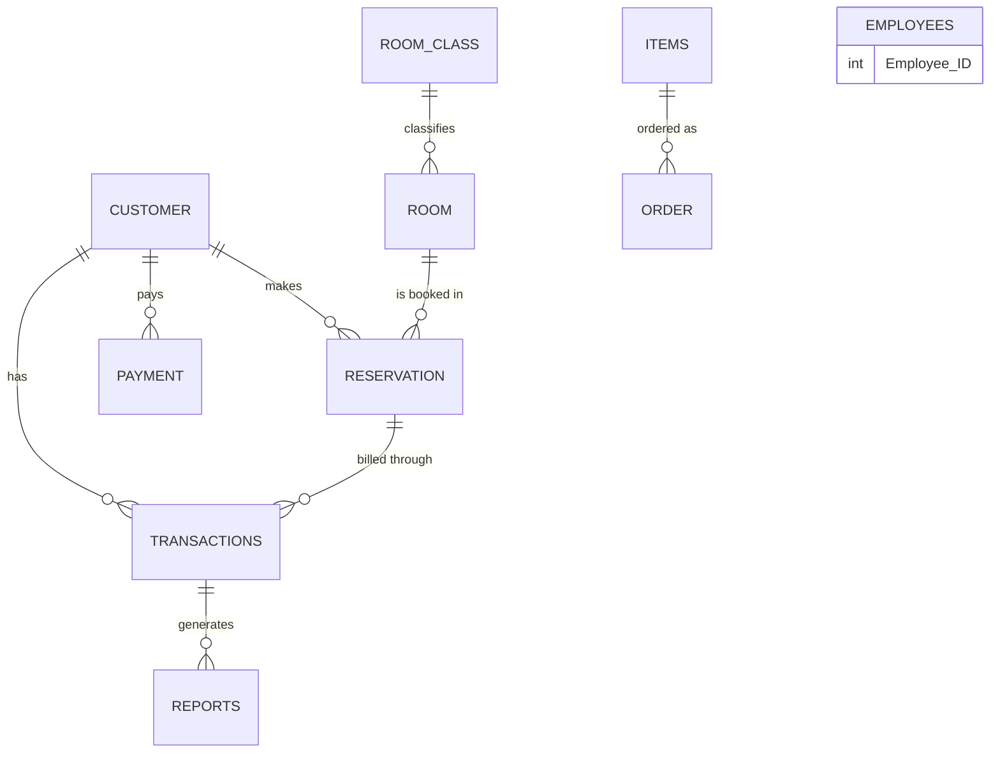

<h1 align="center">🏨 Hotel Management System Database</h1>

<p align="center">A database for a hotel management system that stores information about customers, employees working in the hotel, item details, order details, payment details, room availability and room class, check-in and check-out, transactions, and the reports generated after payment.</p>

<p align="center">
  
  
  
  
</p>

<p align="center">
  <a href="#-entity-relationship-diagram"><b>ER diagram</b></a> ·
  <a href="#-tables">Tables</a> ·
  <a href="#-quick-start">Quick start</a> ·
  <a href="#-whats-in-this-repo">Contents</a>
</p>

---

## 🗺️ Entity relationship diagram



## 🧾 Tables

| Table | What it stores | Links to |
|---|---|---|
| `customer` | Guest details | referenced by reservations, payments and transactions |
| `employees` | Hotel staff | standalone |
| `room_class` | Room categories | referenced by `room` |
| `room` | Rooms and their availability | `room_class` |
| `reservation` | Bookings: reservation date, check-in and check-out dates, length of stay, status | `customer`, `room` |
| `items` | Items the hotel sells or provides | referenced by `order` |
| `order` | Orders for items | `items` |
| `payment` | Payments made by customers | `customer` |
| `transactions` | Financial transactions tied to a booking | `customer`, `reservation` |
| `reports` | Reports generated after payment | `transactions` |

Primary and foreign keys are defined in each table file, so the relationships above are enforced by the database (InnoDB).

## 🚀 Quick start

Requires MySQL or MariaDB (for example through XAMPP, with phpMyAdmin).

1. Extract `SQL Files.rar`. It contains one `.sql` file per table: `customer`, `employees`, `items`, `order`, `payment`, `reports`, `reservation`, `room`, `room_class` and `transactions`.
2. Create a database, for example `hotel`.
3. Import the files into it, **parents before children** so foreign keys resolve: `customer`, `room_class`, `room`, `items`, `employees`, then `reservation`, `order`, `payment`, `transactions`, and finally `reports`. In phpMyAdmin use *Import*, or from the command line:

   ```bash
   mysql -u root -p hotel < "SQL Files/customer.sql"
   ```

The files include sample rows, for example reservations with check-in and check-out dates and an occupied status.

## 📁 What's in this repo

| File | Purpose |
|---|---|
| `SQL Files.rar` | The ten table definitions with sample data (phpMyAdmin dumps) |
| `Database final report.pdf` | Final project report |
| `Video Link.txt` | Link to the project walkthrough video |
